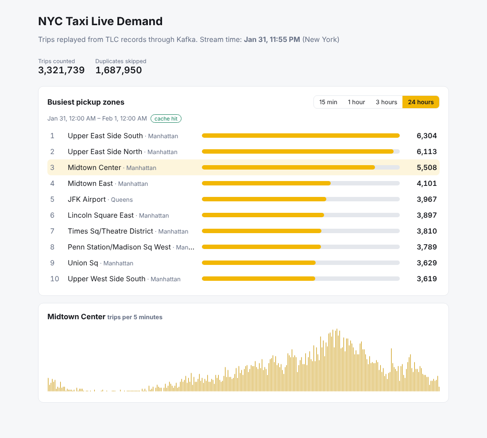
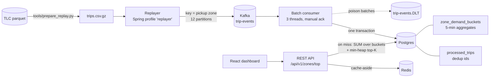

# Real-Time Taxi Demand Service

A streaming backend that replays NYC TLC Yellow Taxi trips through Kafka, counts demand per pickup zone **exactly once** even when events are duplicated or redelivered, and serves "busiest zones in the last N minutes" through a cached REST API and a React dashboard.

It is the engineering companion to the [analysis notebooks](../README.md) in this repo: the notebooks answer *what* the demand looks like; this service computes it continuously from an event stream.



**Stack:** Java 21 · Spring Boot 3 · Apache Kafka (KRaft) · PostgreSQL 16 · Redis 7 · Flyway · React + TypeScript (Vite) · JUnit 5 · Testcontainers · k6 · Docker Compose · GitHub Actions

## Results

Measured on the real January 2025 TLC data (3,321,739 valid trips) on a **2-vCPU, 8 GB sandbox with Kafka, Postgres, Redis, the service, the replayer and k6 all on the same machine**. A real deployment with separate hosts should do better; treat these as a floor.

| What | Result |
|---|---|
| End-to-end ingestion (Kafka → dedup → Postgres upsert), 1M new trips | **~28.8K trips/s** |
| Correctness: full month replayed **twice** with 1% injected duplicates (6.7M deliveries) | **3,321,739** trips counted, exactly the number of unique trips |
| Top-K API p95 at 500 req/s, served from Redis (dashboards polling the current window) | **1.5 ms** |
| Top-K API p95 at 500 req/s, cache misses (random historical windows aggregated in Postgres) | **9.8 ms** |
| Failed requests across all load tests | **0** |

Reproduce: `loadtest/ingest_benchmark.sh` and `k6 run [-e MODE=miss] loadtest/top_zones.js`.

## Architecture



## How it works

### Exactly-once counting on an at-least-once stream

Kafka guarantees at-least-once delivery: producer retries, consumer rebalances, and crashes between "write to DB" and "commit offset" all produce duplicates. The service makes each count **idempotent** instead of trying to prevent duplicates:

1. **Deterministic trip ids.** TLC records have no primary key, so `TripIds` hashes the fields that identify a physical trip (SHA-256, truncated to 128 bits). The same trip always gets the same id, wherever it came from.
2. **Claim, then count, in one transaction** (`TripBatchProcessor`):
   ```sql
   INSERT INTO processed_trips (trip_id, pickup_time)
   SELECT * FROM unnest(?::varchar[], ?::timestamptz[])
   ON CONFLICT (trip_id) DO NOTHING
   RETURNING trip_id;          -- only ids nobody claimed before come back
   ```
   Only the returned ids are aggregated per (zone, 5-minute bucket) and upserted into `zone_demand_buckets`.
3. **Offsets after commit.** The listener acknowledges offsets only after the transaction commits. A crash in between causes redelivery, which step 2 turns into a no-op.
4. **Concurrency.** The primary key is the arbiter: if two consumers race on the same id, Postgres makes the second wait for the first and then reports a conflict. Rows are written in sorted key order so concurrent batches lock rows in the same order and cannot deadlock.

### Bounded dedup state, without double counting

`processed_trips` would grow forever, so ids older than a 7-day retention window are purged. Full-scale testing found two bugs in the first versions of that purge, both now fixed and covered by regression tests in `DedupRetentionIT`:

- **Bug 1: replays after a purge double counted.** Replaying the month a second time re-sent trips whose ids had been purged, and ~109K were counted again. **Fix:** a persisted `dedup_horizon`. Events older than it are rejected and counted as `lateRejected`, never re-counted. Batches read the horizon with `FOR SHARE`; the purge job advances it with an `UPDATE`, so the two serialize correctly.
- **Bug 2: a fast partition moved the horizon past slow ones.** The horizon was first derived from the newest event across all partitions. During a full-speed replay some partitions ran days ahead, and ~538K first-time trips on lagging partitions were wrongly rejected. **Fix:** the horizon now follows the **low watermark**: each batch records its partition's newest event time (`partition_progress`, same transaction), the purge uses the *minimum* across partitions, and nothing is purged until every partition has reported.

After both fixes, the month replayed twice (6.7M deliveries, cleanup running every 10 s) yields exactly 3,321,739 trips.

### Read path

- **Sliding windows over pre-aggregated buckets.** A window of N minutes is a `SUM` over N/5 bucket rows per zone, using an index on `bucket_start`. Windows are event-time and bucket-aligned; the default "now" is the newest bucket with data.
- **Top-K with a bounded min-heap** (`TopK`): O(n log k) over the ~260 zones, deterministic tie-break by zone id.
- **Redis cache-aside** (`TopZonesCache`). Keys encode the window end, length and k, so a new bucket produces a new key. Windows that still include the newest (filling) bucket expire in 5 s; closed historical windows live for 10 minutes. The cache **fails open**: if Redis is down or slow (250 ms timeout), requests fall through to Postgres instead of failing. The `X-Cache: HIT|MISS` header shows which path served a response.
- Invalid parameters return RFC 9457 problem responses (400), not 500s.

## API

| Endpoint | Description |
|---|---|
| `GET /api/v1/zones/top?k=10&windowMinutes=60[&asOf=2025-01-15T18:00:00Z]` | Busiest pickup zones in the window. `k` 1–50, window 5–1440 min in multiples of 5. |
| `GET /api/v1/zones/{zoneId}/demand?windowMinutes=180` | Trips per 5-minute bucket for one zone. |
| `GET /api/v1/stats` | Stream watermark and counts: applied, duplicates skipped, malformed, late-rejected. |
| `GET /actuator/health`, `/actuator/prometheus` | Health probes and metrics (`trips.applied`, `trips.duplicates`, `trips.late`, `cache.topzones{result}`). |

## Running it

Prerequisites: Docker, plus Java 21 and Maven if you want to run tests locally.

```bash
# 1. Prepare replay data from a TLC parquet file (uses pandas + pyarrow)
python tools/prepare_replay.py ../data/raw/yellow_tripdata_2025-01.parquet data/trips_2025_01.csv.gz

# 2. Start Kafka, Postgres, Redis, the API (:8080) and the dashboard (:3000)
docker compose up -d --build

# 3. Stream trips: 60x speed by default (one hour of trips per minute)
docker compose --profile replay up replayer
#    as fast as possible, with 1% duplicates injected:
REPLAY_SPEEDUP=0 REPLAY_DUPLICATE_RATE=0.01 docker compose --profile replay up replayer
```

Then open http://localhost:3000.

## Tests

```bash
mvn verify      # 27 unit tests (surefire) + 12 Testcontainers integration tests (failsafe)
```

Integration tests run against real Kafka, Postgres and Redis containers:

- `IdempotentIngestionIT`: every trip published twice in shuffled order plus malformed records, end to end through Kafka; per-zone totals must match exactly.
- `ConcurrentProcessingIT`: 8 threads processing overlapping batches (each trip in 4 batches); a committed batch reprocessed after a simulated crash; duplicates within one batch.
- `DedupRetentionIT`: regression tests for both retention bugs above.
- `TopZonesApiIT`: ranking, historical windows, cache MISS then HIT, validation errors.

The dedup tests were verified by mutation: disabling the `ON CONFLICT` check, the horizon check, or the low watermark (MIN → MAX) each makes the corresponding tests fail.

CI (`.github/workflows/realtime-service.yml`) runs the full suite, builds the dashboard, and builds the Docker images on every push that touches this folder.

## Project layout

```
src/main/java/.../taxidemand/
  ingest/   TripEvent, TripIds, TripBatchProcessor, TripEventConsumer, DedupRetentionJob
  query/    TopK, WindowResolver, DemandRepository, TopZonesService
  cache/    TopZonesCache (Redis cache-aside, fail-open)
  api/      DemandController, StatsController, ApiExceptionHandler
  replay/   TripReplayer, TripCsvParser (producer-only 'replayer' profile)
src/main/resources/db/migration/   Flyway schema (V1 demand tables, V2 dedup horizon, V3 partition progress)
frontend/                          React + TypeScript dashboard
loadtest/                          k6 read-path test, ingestion benchmark
tools/prepare_replay.py            TLC parquet -> replay CSV
```

## Trade-offs and limits

- **Dedup window.** Duplicates are detected for 7 days of event time; older events are rejected as late, not counted. That trades unbounded state for a clear, observable rule.
- **Single Postgres.** Every batch writes dedup ids, so Postgres is the throughput ceiling. Next steps would be partitioning `processed_trips` by time (cheap purges via `DROP PARTITION`), or Kafka transactions with a state store.
- **Per-instance stats.** `/api/v1/stats` counters reset on restart; durable totals live in Postgres and Prometheus.
